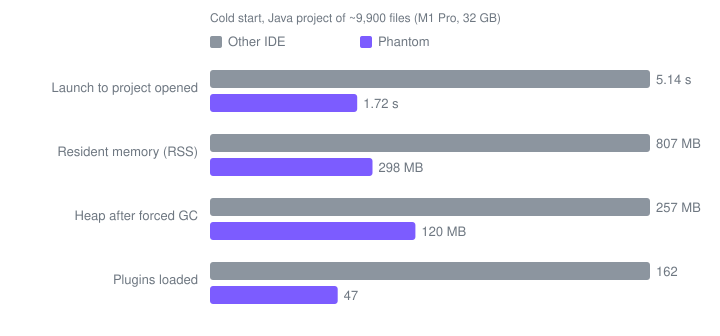

# Performance

Measured on 2026-11-21 on one machine: Apple M1 Pro, 32 GB RAM, macOS 27.0. Most values come from a single run, so read them as rough sizes, not exact figures.

## Phantom vs another IDE

Phantom PH-261121.4 against another commercial IDE on the same platform version. Both ran cold (fresh config and system folders) on a generated Java project of about 9,900 files.

| | Other IDE | Phantom |
|---|---|---|
| Launch to project opened | 5.14 s | 1.72 s |
| Resident memory (RSS) | 807 MB | 298 MB |
| Heap after a forced GC | 257 MB | 120 MB |
| Plugins loaded | 162 | 47 |
| Indexing | 4.8 s | 5.6 s |

- Launch to project opened is `totalDuration` in the startup report (`-Didea.log.perf.stats.file`).
- RSS was read with `ps` once startup settled; heap with `jcmd GC.heap_info` after `jcmd GC.run`.
- The two indexing numbers are not measured the same way. Treat them only as "about the same".
- A warm-start comparison was not usable: other jobs pushed the machine's load average to 57 during those runs. It still needs a re-run on an idle machine.

## Phantom changes

| Change | Before | After |
|---|---|---|
| AOT cache built with the app (#65) instead of the dynamic CDS archive, launch to project opened (median of 5) | 1.88 s | 1.62 s |
| TextMate ships 22 grammars instead of all (#66): time smart mode waits for TextMate | 646 ms | 384 ms |
| Same change, TextMate background class loading | 1,348 ms | 366 ms |

- The AOT cache adds about 345 MB to the app. The DMG grows from 648 MB to 692 MB.

## How to reproduce

- Give the app its own config, system, plugins and log folders through `PHANTOM_PROPERTIES` (the other IDE has its own properties variable).
- Pass the startup report path and the trust and consent flags through `PHANTOM_VM_OPTIONS`.
- Open the project from the command line.
- Quit the app normally (`NSRunningApplication terminate`, with `confirmExit` off). SIGTERM skips writing the dynamic CDS archive, so the next start is slower than it should be.
- For an AOT build, confirm the cache was actually used: `jcmd <pid> VM.info` should show `CDS: on`. The JVM drops a cache without warning when a jar's timestamp or size no longer matches.
